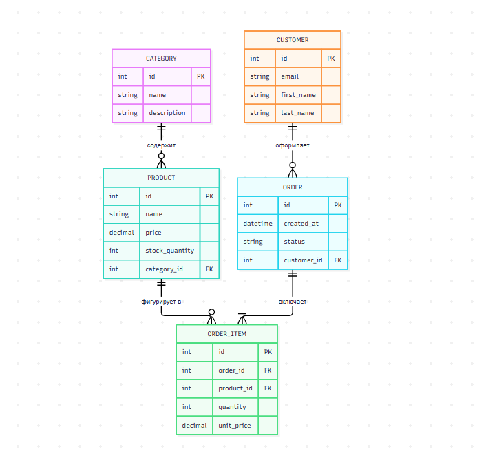

# Лабораторная работа № 1

**Кафедра «Цифровая экономика»**

**ЛАБОРАТОРНАЯ РАБОТА № 1**
по дисциплине «Основы применения веб-технологий»
Тема: «Проектирование веб-приложения и формулирование требований»

Студент гр. О-24-БИ-цэ-Б
________________Тризна К.А
№ зач. Книжки_______
Преподаватель: Калинин В. С
_______________

Брянск 2026

---

## 1. Сформулируйте назначение приложения

Веб-приложение предназначено для продажи товаров для животных. Посетитель может просматривать каталог, зарегистрированный пользователь — оформлять заказы, администратор — управлять товарами и заказами.

---

## 2. Определите пользователей и роли

| Роль | Возможные действия |
|---|---|
| Гость | Просматривать карточки товаров и каталог. |
| Покупатель | Создавать заказы, просматривать их, а также управлять профилем. |
| Администратор | Создавать товары, изменять их, просматривать заказы. |

---

## 3. Составьте перечень функциональных требований

1. **Поиск товаров по категориям:** Система должна предоставлять возможность поиска товаров по категориям (например, корма, игрушки, аксессуары для ухода) с отображением результатов на экране.
2. **Оформление заказа:** Возможность оформления заказа с указанием адреса доставки, способа оплаты и получения номера заказа.
3. Система должна показывать список доступных товаров.
4. **Фильтрация товаров по параметрам:** Возможность фильтрации товаров по параметрам, таким как цена, бренд.
5. **Добавление товаров в корзину:** Система должна позволять пользователю добавлять товары в виртуальную корзину с возможностью последующего редактирования количества товаров.
6. **История заказов:** Возможность просмотра истории заказов пользователя с детализацией каждого заказа (статус, дата, товары).
7. Администратор должен иметь возможность изменить статус заказа.
8. **Управление учетными записями клиентов:** Система должна поддерживать регистрацию и аутентификацию пользователей с возможностью редактирования профиля.

---

## 4. Опишите нефункциональные требования

1. **Пароли должны быть защищены.** Система не хранит пароли как обычный текст, а превращает их в непонятный набор символов (хеш).
2. **Страницы с товарами должны быстро открываться.** Каталог должен загружаться не дольше 2 секунд при обычном интернете.
3. **Данные хранятся в обычной «табличной» базе.** Все данные (товары, заказы, клиенты) лежат в реляционной базе (вроде MySQL или PostgreSQL) — как аккуратные таблицы со связями.
4. **Интерфейс должен корректно отображаться на мобильном экране.**

---

## 5. Составьте пользовательские сценарии

### Сценарий 1: Оформление заказа

**Название:** Оформление заказа
**Участник:** Покупатель

**Начальные условия:**
1. Пользователь успешно авторизовался в системе.
2. В каталоге доступны выбранные товары.

**Последовательность действий:**
1. Пользователь выбирает товар из каталога и добавляет его в корзину.
2. Переходит в раздел оформления заказа.
3. Указывает адрес доставки.
4. Выбирает способ оплаты из предложенных вариантов.
5. Подтверждает заказ и завершает процесс оформления.

**Ожидаемый результат:**
1. В системе создается заказ с выбранными позициями.
2. Пользователь получает уведомление о подтверждении заказа с номером заказа.
3. Данные заказа сохраняются в базе данных, и пользователю отправляется подтверждение на email.

### Сценарий 2: Поиск товара по категории

**Название:** Поиск товара по категории
**Участник:** Покупатель

**Начальные условия:**
1. Пользователь не знает точное название товара.
2. Пользователь знает категорию товара (например, корм, игрушки).

**Последовательность действий:**
1. Пользователь выбирает категорию товара из списка.
2. Система отображает список товаров данной категории.
3. Пользователь применяет фильтры (например, по цене, бренду).
4. Выбирает нужный товар и переходит к его описанию.

**Ожидаемый результат:**
1. Пользователь видит список доступных товаров выбранной категории.
2. Товарная информация (описание, цена, наличие) отображается корректно.
3. Пользователь может выбрать товар для покупки.

### Сценарий 3: Ошибка при оформлении заказа (недостаточно товара на складе)

**Название:** Ошибка при оформлении заказа
**Участник:** Покупатель

**Начальные условия:**
1. Пользователь выбрал товар и добавил его в корзину.
2. Пользователь пытается оформить заказ.

**Последовательность действий:**
1. Пользователь переходит к оформлению заказа.
2. Система проверяет наличие товара на складе.
3. Обнаруживается, что товара недостаточно для выполнения заказа.
4. Система отображает сообщение об ошибке.

**Ожидаемый результат:**
1. Пользователь видит сообщение об ошибке: «Товар отсутствует на складе».
2. Пользователь не может оформить заказ.
3. Система предлагает пользователю следующие варианты:
   1. Выбрать другой товар.
   2. Подождать поступления товара.
   3. Связаться с поддержкой для уточнения информации о наличии товара.

---

## 6. Выделите сущности и их атрибуты

| Сущность | Примеры атрибутов |
|---|---|
| Category | id, name, description. Обязательные поля: name Ограничения: name должно быть уникальным |
| Product | id, name, description, price, stock_quantity (количество на складе). Обязательные поля: name, price, stock_quantity Ограничения: stock_quantity должно быть неотрицательным |
| Customer | id (первичный ключ), email (email), first_name (имя), last_name (фамилия). Обязательные поля: email, first_name, last_name Ограничения: email должен быть уникальным |
| Order | id (первичный ключ), created_at (дата и время создания заказа), status (статус заказа: в обработке, отправлен, доставлен и т.д.), customer_id (идентификатор клиента). Обязательные поля: created_at, status, customer_id Ограничения: статус должен быть одним из предопределенных значений |
| OrderItem | id (первичный ключ), order_id (идентификатор заказа), product_id (идентификатор продукта), quantity (количество), unit_price (цена за единицу). Обязательные поля: order_id, product_id, quantity, unit_price Ограничения: quantity должно быть неотрицательным, unit_price не должно быть нулевым |

---

## 7. Определите связи между сущностями

| Сущность 1 | Связь | Сущность 2 | Кратность | Предметный смысл |
|---|---|---|---|---|
| Category | содержит | Product | 1 : M | Одна категория включает множество товаров; каждый товар относится строго к одной категории |
| Customer | оформляет | Order | 1 : M | Один клиент может оформить множество заказов; каждый заказ принадлежит одному клиенту |
| Order | включает | OrderItem | 1 : M | Один заказ содержит множество позиций; каждая позиция относится к одному заказу |
| Product | фигурирует в | OrderItem | 1 : M | Один товар может встречаться во множестве позиций заказов (в разных заказах); каждая позиция заказа ссылается на один товар |

---

## 8. Постройте ER-диаграмму

